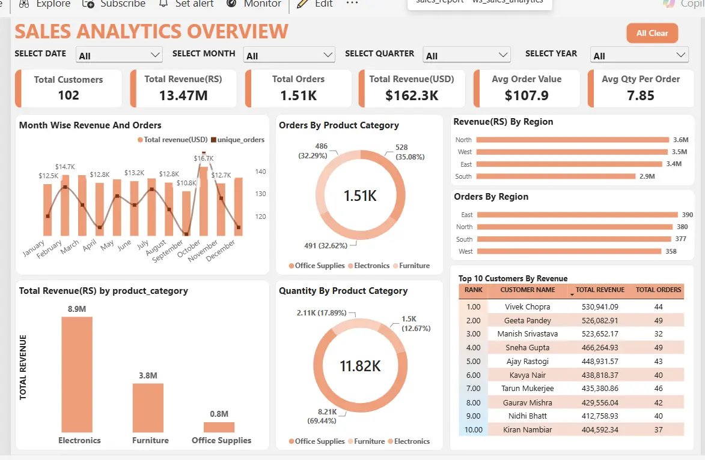
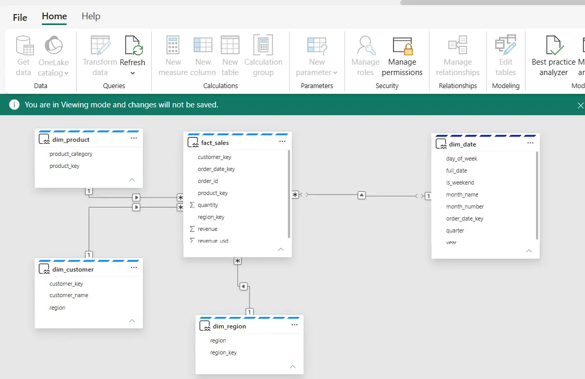
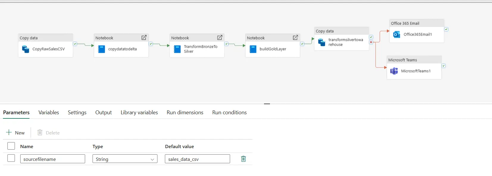
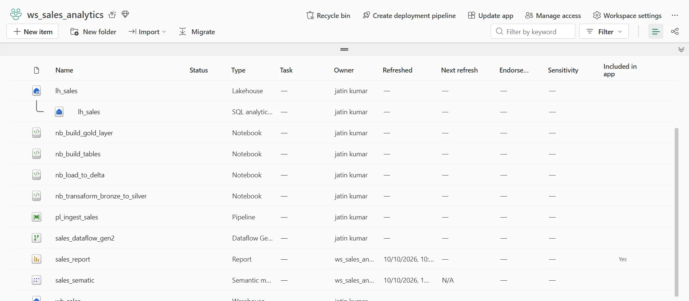

# Sales Analytics — Microsoft Fabric End-to-End

A compact end-to-end sales analytics implementation built in **Microsoft Fabric**. The project demonstrates how raw sales data can move through ingestion, transformation, analytical modelling, and reporting layers to produce a trusted Power BI dashboard.

> This repository is a visual case study. It contains project documentation and screenshots of the implemented Fabric artifacts.

## Project Objective

The objective was to understand and implement the complete analytics workflow inside Microsoft Fabric:

- Ingest raw sales data into OneLake.
- Organize data through Bronze, Silver, and Gold layers.
- Clean and validate sales records before reporting.
- Build analytical fact and dimension tables.
- Create a Power BI semantic model using a star schema.
- Validate report KPIs against the transformed data.

## Architecture

```text
Raw sales CSV
      ↓
Fabric Data Pipeline / Dataflow Gen2
      ↓
Bronze — raw data in Fabric Lakehouse
      ↓
Silver — cleaned, typed, standardized, and deduplicated data
      ↓
Gold — business-ready fact and dimension tables
      ↓
Fabric Warehouse / Semantic Model
      ↓
Power BI Sales Dashboard
```

## Microsoft Fabric Components

| Component | Purpose |
|---|---|
| OneLake | Central storage layer for the project |
| Fabric Lakehouse | Storage of raw and transformed Delta tables |
| Data Pipeline | Data ingestion and workflow orchestration |
| Dataflow Gen2 | Low-code data preparation and loading |
| Fabric Notebook | PySpark-based cleaning and table creation |
| Fabric Warehouse | SQL-based analytical serving layer |
| Semantic Model | Star-schema relationships, measures, and reporting logic |
| Power BI | KPI reporting and interactive business analysis |

## Data Transformation

The source contained **1,525 rows**. A data-quality audit compared the total row count with distinct order identifiers and identified **20 duplicate order records**.

The Silver layer applied the following preparation steps:

- Corrected data types.
- Standardized column values.
- Checked null values.
- Removed duplicate order records.
- Created analysis-ready columns.
- Revalidated row counts and business totals.

The resulting analytical dataset contained **1,505 valid orders**.

## Analytical Model

The reporting layer follows a star-schema approach:

```text
             dim_customer
                  │
                  │
dim_product ── fact_sales ── dim_region
                  │
                  │
               dim_date
```

- `fact_sales` stores transaction-level sales events and numeric measures.
- `dim_customer` provides customer attributes.
- `dim_product` provides product and category context.
- `dim_region` supports geographical analysis.
- `dim_date` supports monthly, quarterly, and yearly reporting.

Relationships use one-to-many cardinality from dimensions to the fact table with single-direction filtering.

## Dashboard Coverage

The Power BI report presents:

- Total revenue and order count.
- Sales trends over time.
- Revenue by region.
- Product-category performance.
- Top-customer analysis.
- Date, region, and category filtering.

## Data Quality Validation

The following checks were performed before reporting:

1. Compared source and transformed row counts.
2. Compared total rows with distinct order identifiers.
3. Checked key columns for missing values.
4. Verified data types after transformation.
5. Recalculated business totals outside the report.
6. Compared report KPIs with Lakehouse and SQL results.

The duplicate audit corrected the order count from **1,525 rows to 1,505 valid orders** before final reporting.

## Tools and Skills Demonstrated

- Microsoft Fabric
- OneLake
- Fabric Lakehouse
- Fabric Warehouse
- Data Pipeline
- Dataflow Gen2
- PySpark
- Spark SQL
- T-SQL
- Delta Lake
- Dimensional modelling
- Star schema
- Power BI
- DAX
- Data-quality validation

## Project Screenshots

### Power BI Dashboard



### Star-Schema Semantic Model



### Fabric Pipeline



### Fabric Workspace



> Additional screenshots can be added as the project is extended.

## Scope

This project was intentionally built as a compact implementation to practise the complete Microsoft Fabric analytics workflow. The dataset is small, so the focus is platform integration, modelling, validation, and end-to-end understanding rather than large-scale performance optimisation.

A separate, larger Analytics Engineering project will demonstrate more extensive SQL transformations, modular dbt models, automated tests, documentation, lineage, and deployment practices.

## Key Learning

The most important lesson from this project was that a dashboard is only the final presentation layer. Reliable analytics requires traceable ingestion, cleaned and validated data, clearly defined table grain, correct relationships, and KPI verification across every stage.

## Dataset Credit

Dataset: `sales_data.csv`, a public tutorial dataset provided through Mansi Goel's Microsoft Fabric learning project.
